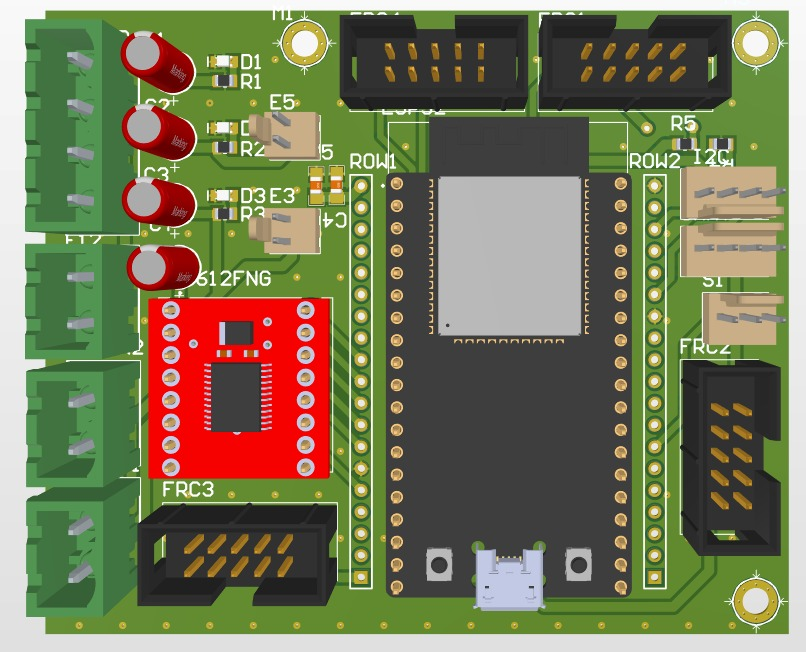

# Custom ESP32 Controller Board
### PCB Design & Hardware Integration

## Overview
Designed a custom ESP32-based PCB using **Altium Designer**, integrating motor control, power connections, and peripheral interfaces into a single board for embedded hardware applications.

## Features
- Custom PCB layout for an ESP32 development module.
- Integrated **TB6612FNG dual H-bridge motor driver** for DC motor control.
- Dedicated motor output terminals for hardware connectivity.
- Power input connectors and supporting power circuitry.
- FRC connectors for external modules and peripherals.
- Dedicated interfaces for **UART, I2C, and other peripheral connections**.
- Through-hole headers for ESP32 GPIO access and hardware expansion.
- 2D PCB routing views and 3D board visualization for design review.

## Design Tools
- **PCB Design:** Altium Designer
- **Microcontroller:** ESP32
- **Motor Driver:** TB6612FNG
- **Design Focus:** PCB Layout, Hardware Integration, Embedded Systems

## PCB Design

### 3D PCB View
<!-- Add your 3D PCB render here -->

### Fabricated PCB
<!-- Add a photograph of the manufactured PCB here -->

## Key Learning Outcomes
- PCB component placement and routing.
- Microcontroller and motor-driver integration.
- Power distribution and connector planning.
- Peripheral interfacing and PCB design workflow.
- Preparing PCB layouts for fabrication.

## Software
Designed using Altium Designer.
